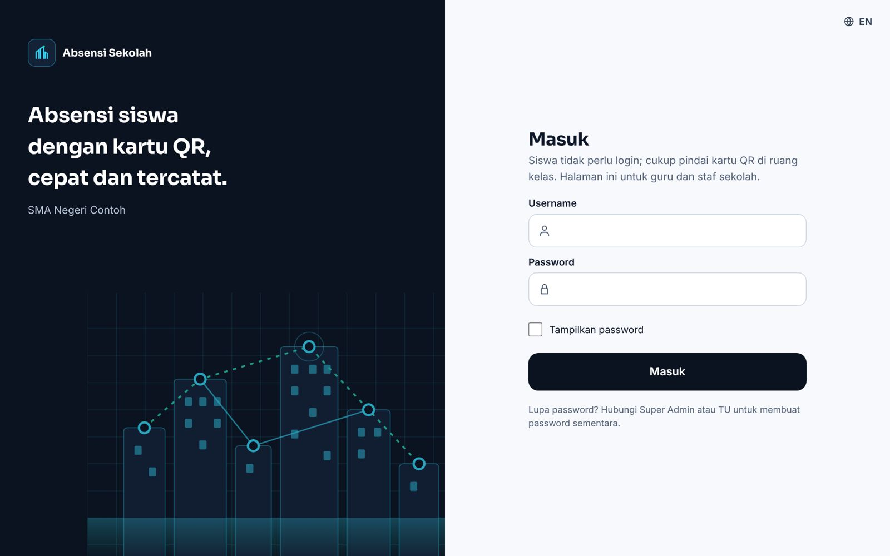

# Pendahuluan

Absensi Sekolah adalah aplikasi web untuk mencatat kehadiran siswa dengan kartu QR. Siswa menempelkan kartunya ke scanner di depan kelas, layar langsung menampilkan nama dan statusnya, dan kehadiran tercatat di server. Guru, wali kelas, TU, dan kepala sekolah melihat hasilnya dari komputer atau ponsel tanpa perlu menyalin absen kertas.

Buku panduan ini menjelaskan cara memasang, menyiapkan, dan memakai aplikasi sehari-hari, dari sudut pandang setiap peran.

## Tujuan aplikasi

- **Cepat di depan kelas.** Satu kartu tercatat dalam waktu kurang dari sepertiga detik, sehingga 36 siswa selesai sebelum bel.
- **Tetap jalan saat internet putus.** Scanner menyimpan scan di perangkat dan mengirimkannya begitu tersambung lagi.
- **Rekap tanpa menyalin.** Rekap harian, bulanan, dan semester dibuat otomatis dalam format yang biasa dipakai sekolah, lengkap dengan kop dan tanda tangan kepala sekolah.
- **Jejak yang jelas.** Setiap izin, koreksi, dan perubahan data tercatat di audit log beserta siapa dan kapan.

## Peran pengguna

| Peran | Yang bisa dilakukan |
| --- | --- |
| Super Admin | Semua fitur, termasuk akun pengguna, pengaturan sekolah, perangkat scanner, kesehatan sistem, dan audit log |
| TU / Staff | Data master (tahun ajaran, kelas, siswa, jadwal, ruangan, jam, libur), impor, kartu QR, izin, rekap |
| Kepala Sekolah | Melihat semua kelas, dashboard, dan rekap; mengunduh laporan. Tidak mengubah data |
| Guru | Melihat sesi kelas yang diajar, mengoreksi status di sesi yang diajarnya |
| Wali kelas | Guru yang menjadi wali sebuah kelas; mencatat izin dan melihat rekap kelasnya |
| Orang tua / siswa | Bila portal dinyalakan: melihat riwayat kehadiran anak sendiri dengan NIS dan kode akses |

## Istilah penting

- **Sesi**: satu waktu absensi untuk satu kelas, misalnya *Masuk X-1* pukul 06:30–07:30 atau *Matematika jam ke-3*. Sesi dibuat otomatis dari pengaturan jam atau jadwal.
- **Kiosk**: tablet atau laptop di depan kelas yang menjalankan halaman scanner (`/kiosk`). Bisa memakai kamera atau scanner USB.
- **Kode status**: **H** Hadir, **T** Terlambat, **S** Sakit, **I** Izin, **D** Dispensasi, **A** Alpa.
- **Prioritas status**: koreksi guru mengalahkan surat izin, surat izin mengalahkan scan, dan scan mengalahkan Alpa otomatis.

## Alur singkat

1. TU menyiapkan data sekolah, kelas, siswa, dan mencetak kartu QR.
2. Super Admin memasangkan satu tablet atau laptop per ruangan sebagai kiosk.
3. Setiap pagi siswa scan kartu. Yang terlambat ditandai otomatis.
4. Saat sesi ditutup, siswa yang tidak scan dan tidak punya surat tercatat Alpa.
5. Wali kelas mencatat izin dan mengoreksi bila perlu; TU dan kepala sekolah melihat rekap.

