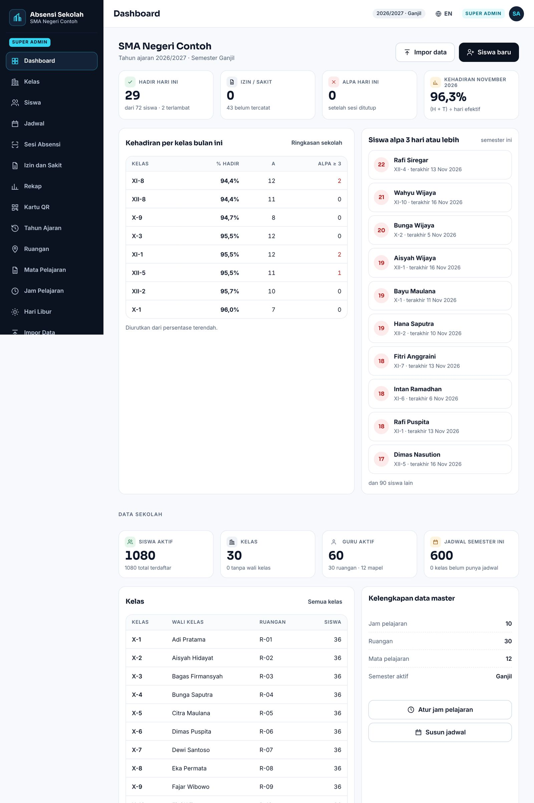
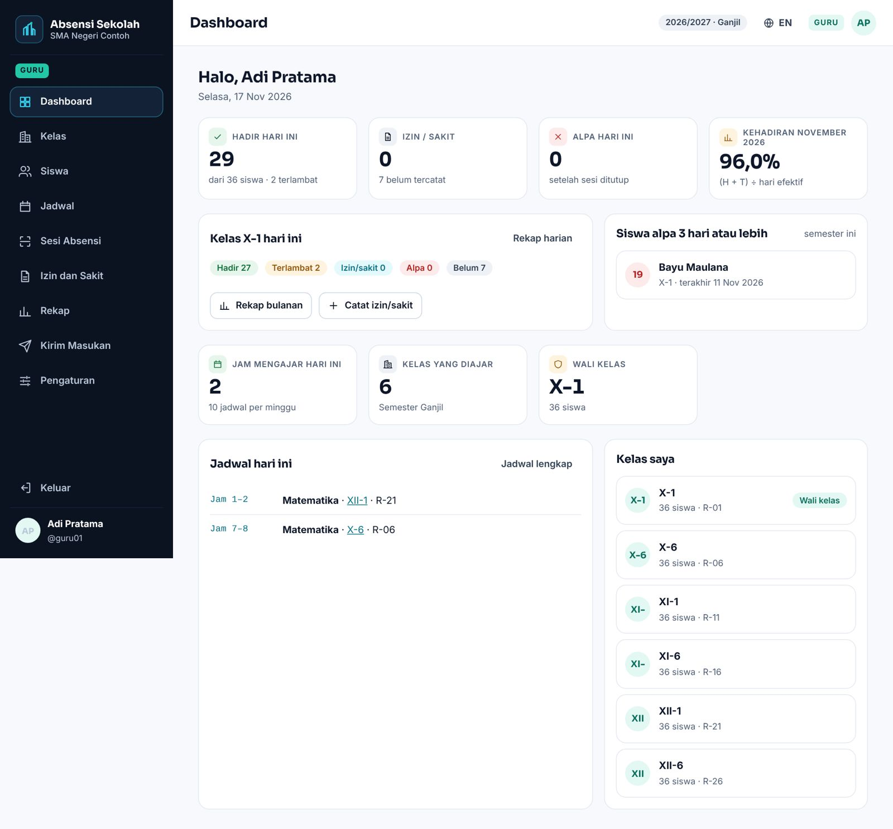
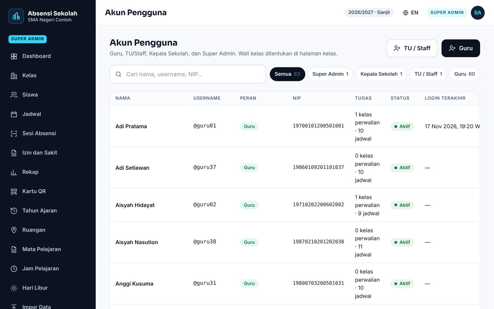

# Masuk dan Akun

## Masuk ke aplikasi

1. Buka alamat aplikasi sekolah di browser.
2. Isi **username** dan **password** yang diberikan Super Admin, lalu tekan **Masuk**.
3. Pada login pertama Anda wajib mengganti password sementara.

- **Lima kali salah** password membuat akun terkunci 15 menit untuk alamat itu.
- **Bahasa** bisa diganti ke English dengan tombol ID/EN di pojok kanan atas.

## Dashboard

Setelah masuk, Anda melihat dashboard sesuai peran:

- **Super Admin, TU, kepala sekolah**: hadir, izin/sakit, dan alpa hari ini; persentase hadir bulan ini; kelas dengan kehadiran terendah; siswa yang alpa 3 hari atau lebih.
- **Wali kelas**: ringkasan kelasnya hari ini, sesi yang sedang berjalan, dan siswa yang perlu diperhatikan.

## Mengelola akun (Super Admin)

Menu **Akun Pengguna** berisi semua akun.

- **Tambah akun**: isi nama, username, peran. Aplikasi membuat password sementara yang ditampilkan sekali; berikan ke pemiliknya.
- **Reset password**: membuat password sementara baru bila pengguna lupa.
- **Nonaktifkan**: akun tidak bisa masuk tetapi riwayatnya tetap tersimpan.
- **Akun guru** dihubungkan ke data guru agar jadwal dan kelas walinya terbaca.

## Profil dan password

Menu **Pengaturan** dipakai semua pengguna untuk mengganti nama tampilan, nomor HP, dan password sendiri.
