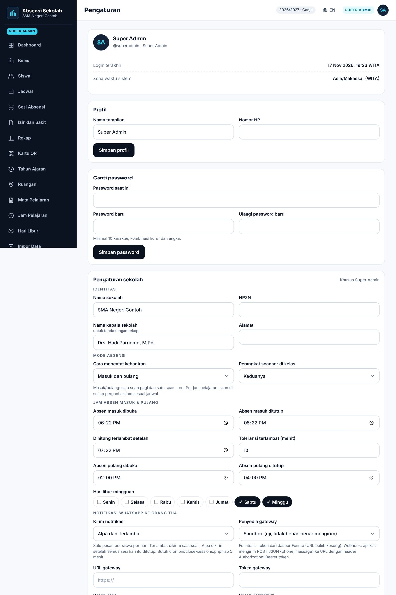
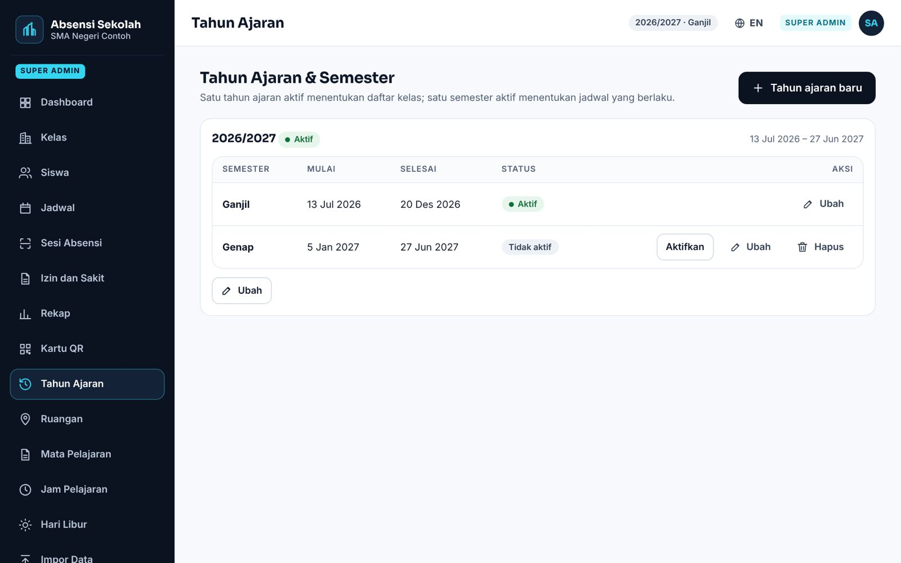
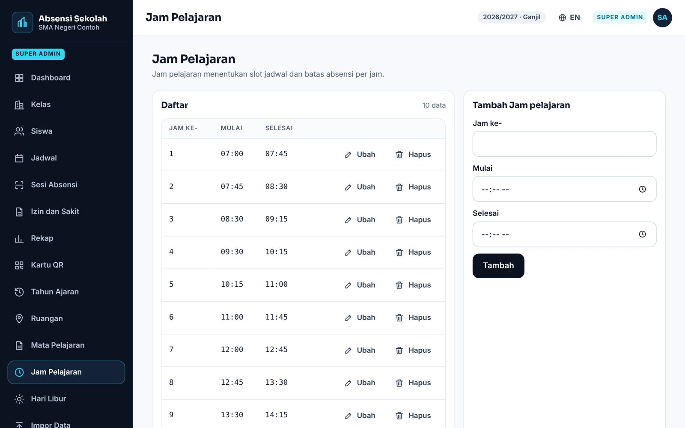
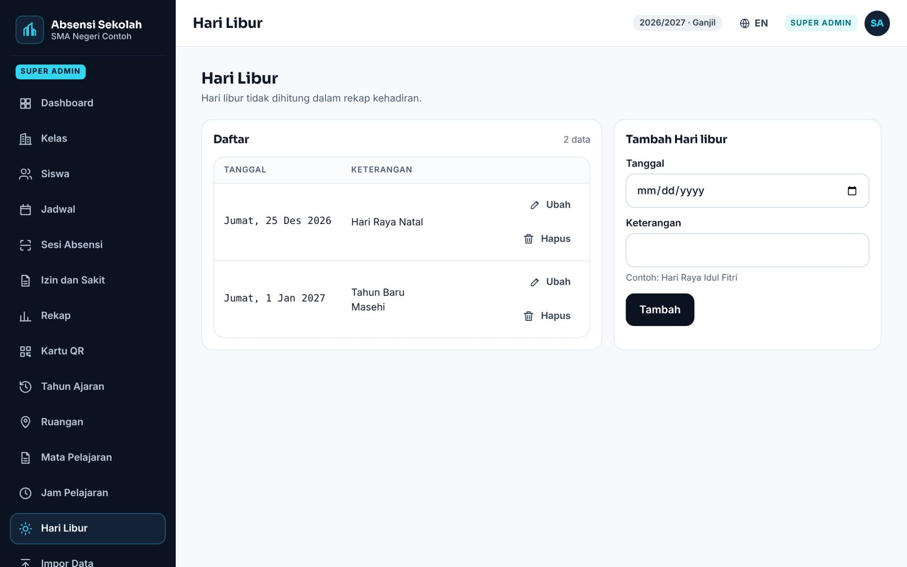
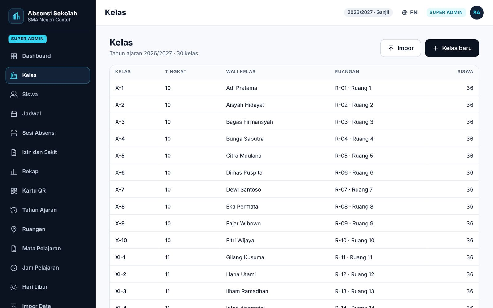
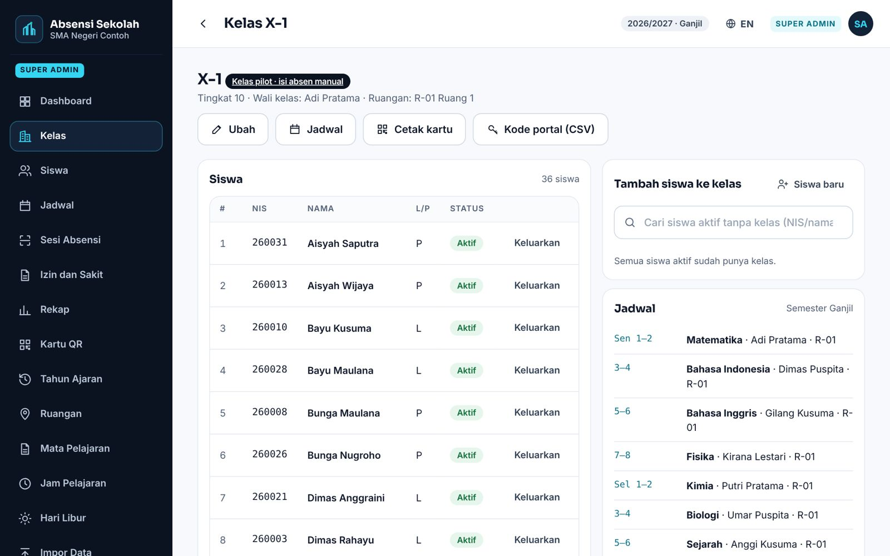
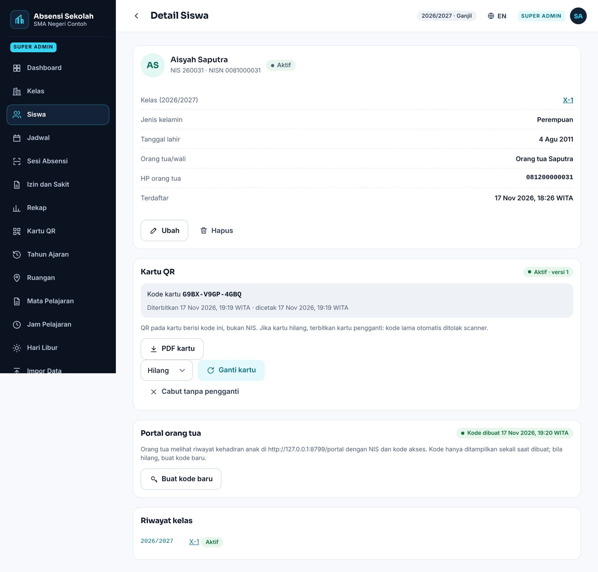
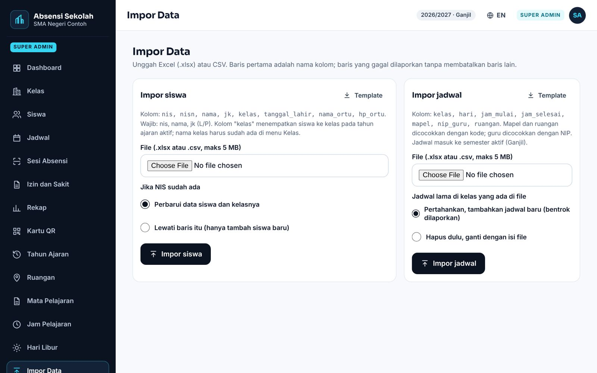
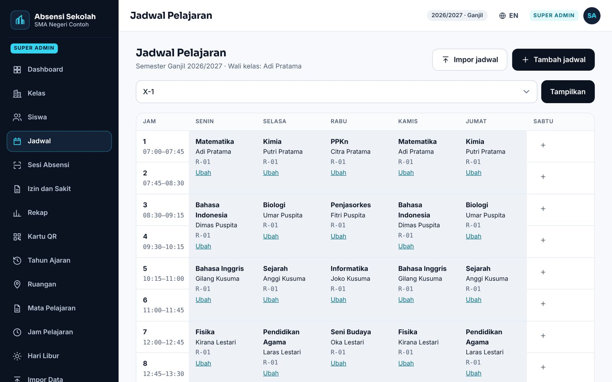
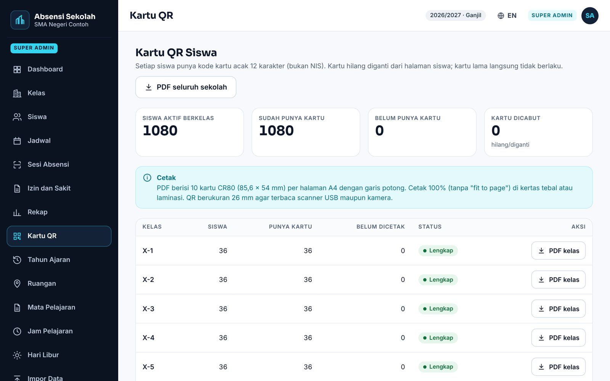

# Persiapan Data Sekolah

Bab ini dikerjakan TU dan Super Admin sekali di awal tahun ajaran, dengan sedikit pembaruan di awal semester.

## Pengaturan sekolah

Menu **Pengaturan** (khusus Super Admin) berisi:

- **Identitas**: nama sekolah, NPSN, alamat, dan nama kepala sekolah untuk tanda tangan rekap.
- **Mode absensi**: *Masuk dan pulang* (satu scan pagi dan satu scan sore), *Per jam pelajaran* (scan di setiap pergantian jam sesuai jadwal), atau keduanya.
- **Jam absen**: kapan absen masuk dibuka dan ditutup, kapan siswa dihitung terlambat, toleransi terlambat dalam menit, serta jam absen pulang.
- **Hari libur mingguan**: biasanya Sabtu dan Minggu.
- **Notifikasi WhatsApp** dan **portal orang tua**: lihat Bab 8.

## Tahun ajaran dan semester

1. Buka **Tahun Ajaran**, tambah tahun ajaran baru (misalnya 2026/2027) beserta semester Ganjil dan Genap.
2. Aktifkan tahun ajaran dan semester yang sedang berjalan. Hanya satu yang aktif pada satu waktu.
3. Rekap dan jadwal selalu mengikuti semester aktif.

## Data master

Data master diisi TU dari menu **Ruangan**, **Mata Pelajaran**, **Jam Pelajaran**, dan **Hari Libur**:

- **Ruangan**: kode dan nama ruangan. Satu kiosk dipasang per ruangan.
- **Mata pelajaran**.
- **Jam pelajaran**: jam ke-1, ke-2, dan seterusnya beserta waktunya (dipakai mode per jam).
- **Hari libur**: tanggal merah dan libur sekolah. Tanggal ini diarsir di rekap dan tidak menghasilkan Alpa.

## Kelas dan siswa

- **Kelas**: nama kelas, tingkat, ruangan, dan **wali kelas**. Wali kelas wajib diisi karena wali kelas yang mencatat izin dan melihat rekap kelasnya.
- **Siswa**: NIS, nama, jenis kelamin, kontak orang tua. Foto siswa bisa diunggah dari halaman detail siswa dan tampil di kiosk.
- **Anggota kelas**: siswa dimasukkan ke kelas dari halaman kelas atau lewat impor.

## Impor dari Excel

Menu **Impor Data** menerima berkas Excel (.xlsx) atau CSV.

1. Unduh **template** siswa atau jadwal.
2. Isi template tanpa mengubah judul kolom.
3. Unggah, lalu periksa pratinjau. Baris yang rusak ditampilkan beserta alasannya dan tidak ikut disimpan.
4. Tekan **Simpan** untuk baris yang benar.

## Jadwal pelajaran

Diperlukan untuk mode **per jam pelajaran**. Jadwal disusun per kelas, hari, dan jam ke-n, lengkap dengan mapel dan guru. Aplikasi menolak jadwal yang bentrok (guru atau ruangan dipakai dua kelas pada jam yang sama).

## Kartu QR siswa

1. Buka **Kartu QR**. Kartu dikelompokkan per kelas.
2. Tekan **Terbitkan** untuk siswa yang belum punya kartu.
3. Tekan **PDF kartu** untuk mencetak satu kelas: kertas A4, 10 kartu ukuran KTP per halaman, siap dipotong dan dilaminasi.
4. Bila kartu hilang, buka detail siswa lalu **Ganti kartu**. Kartu lama langsung tidak berlaku.

- **Kode kartu** adalah 12 karakter acak, tidak berisi NIS atau data pribadi.
- **Kartu dicabut** akan tampil "Kartu tidak berlaku" di kiosk.

