# Absensi Harian

## Memasang perangkat scanner

Dilakukan Super Admin sekali untuk setiap ruangan.

1. Buka **Perangkat Scanner**, tekan **Tambah perangkat**, beri nama (misalnya *Tablet X-1*) dan pilih ruangannya.
2. Aplikasi menampilkan **kode pasangan 6 digit** yang berlaku 15 menit.
3. Di tablet atau laptop kelas, buka `https://<alamat-sekolah>/kiosk`, masukkan kode, lalu tekan **Pasangkan**.
4. Sambungkan scanner USB. Tekan **Layar penuh** agar tampilan tidak bisa ditutup siswa.

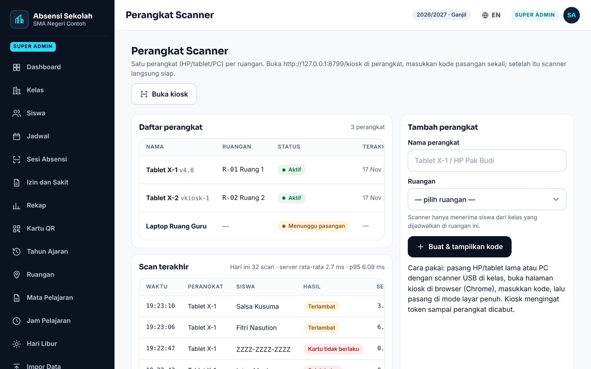

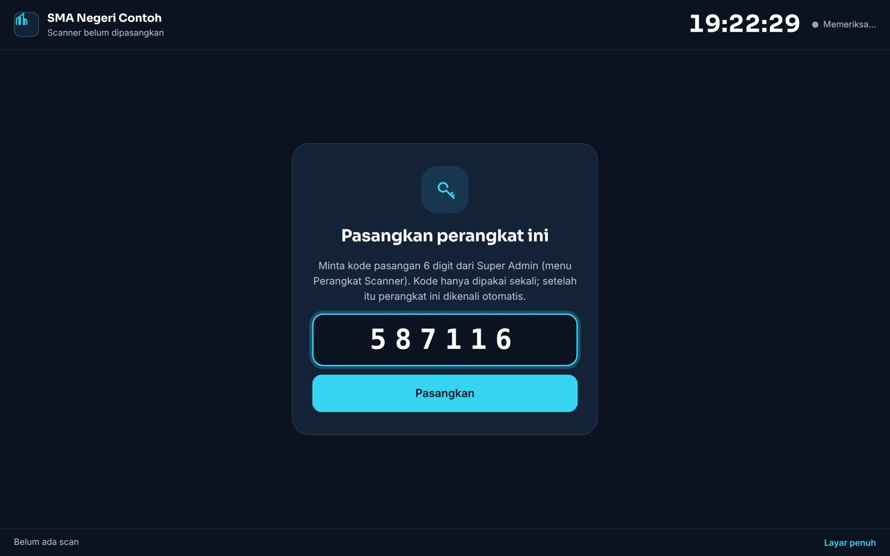

- **Perangkat dicabut** tidak bisa dipakai lagi sampai dipasangkan ulang.
- **Status perangkat** (terakhir terlihat, antrean offline, selisih jam) tampil di halaman ini dan di Kesehatan Sistem.

## Memakai kiosk

Kiosk menampilkan sesi yang sedang berjalan di ruangannya. Siswa cukup menempelkan kartu ke scanner.

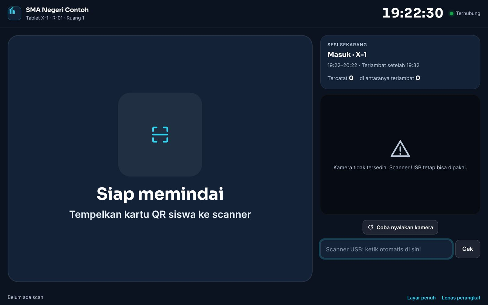

| Warna | Arti |
| --- | --- |
| Hijau, **Hadir** | Tercatat tepat waktu |
| Kuning, **Terlambat N menit** | Tercatat setelah batas terlambat |
| Biru, **Sudah tercatat** | Kartu ini sudah scan di sesi yang sama; tidak dicatat dua kali |
| Merah, **Bukan kelas X-1** | Siswa salah ruangan; tidak dicatat |
| Merah, **Kartu tidak berlaku** | Kartu dicabut, diganti, atau bukan kartu sekolah |

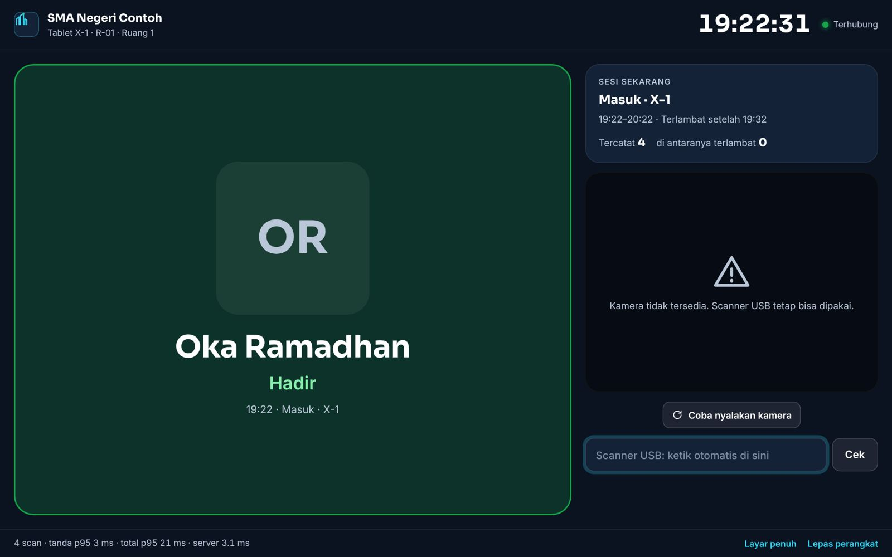

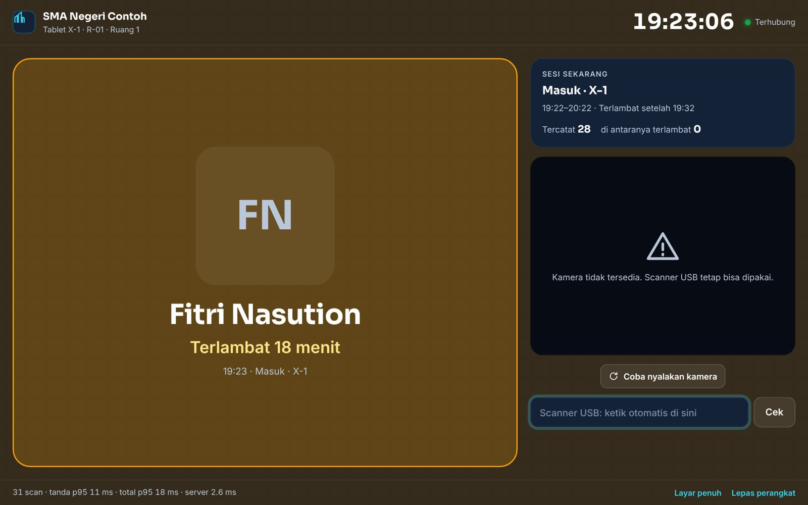

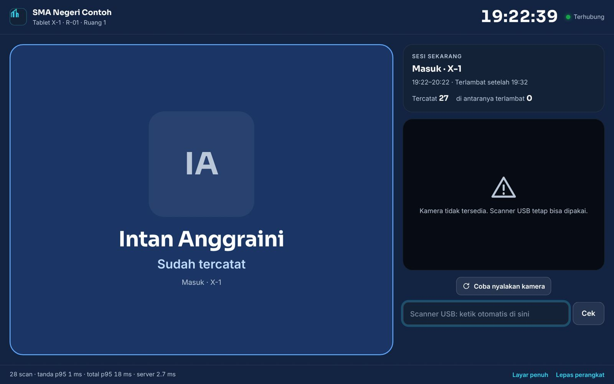

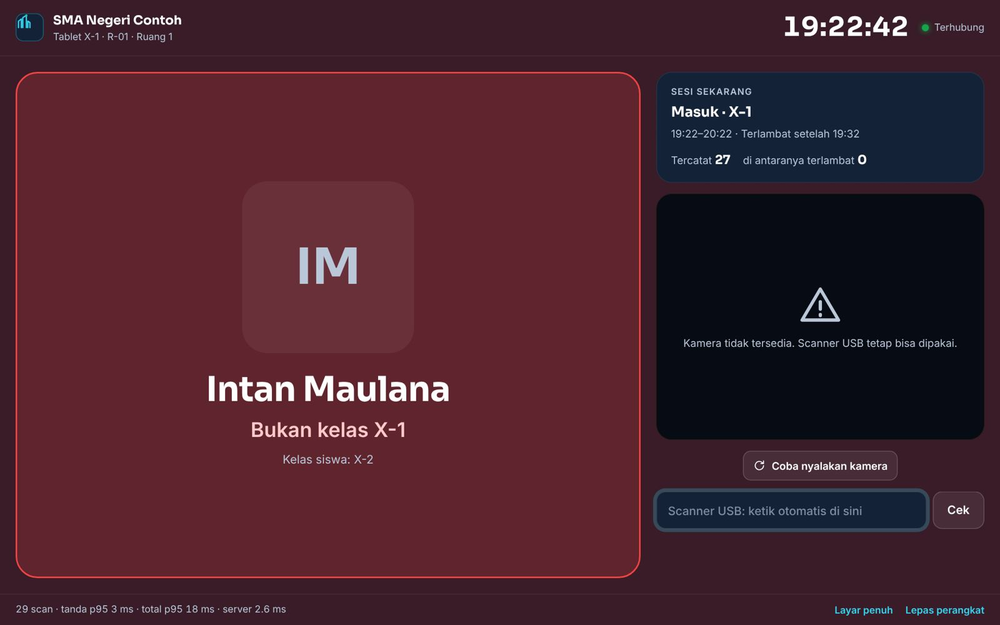

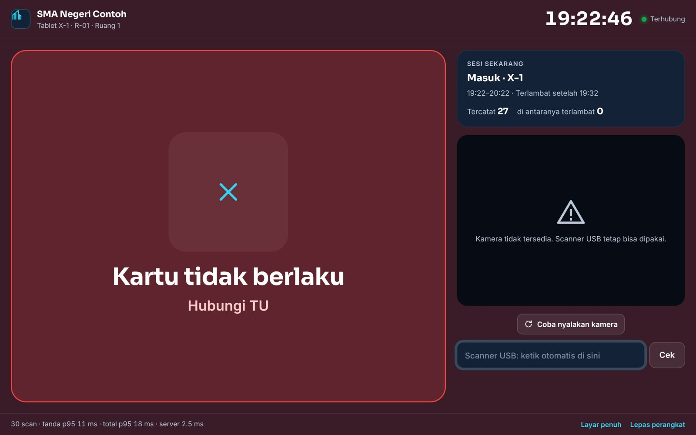

- **Internet putus**: kiosk tetap menampilkan tanda Hadir/Terlambat dari daftar siswa yang tersimpan, lalu mengirim semua scan begitu tersambung lagi. Jangan menutup browser sampai antrean kosong (angka antrean tampil di bagian bawah).
- **Kamera**: bila tidak ada scanner USB, tekan **Coba nyalakan kamera** dan arahkan kartu ke kamera. Kamera hanya bisa dipakai lewat HTTPS.

## Sesi absensi

Menu **Sesi Absensi** menampilkan semua sesi pada tanggal yang dipilih. Guru hanya melihat sesi kelas yang diajarnya.

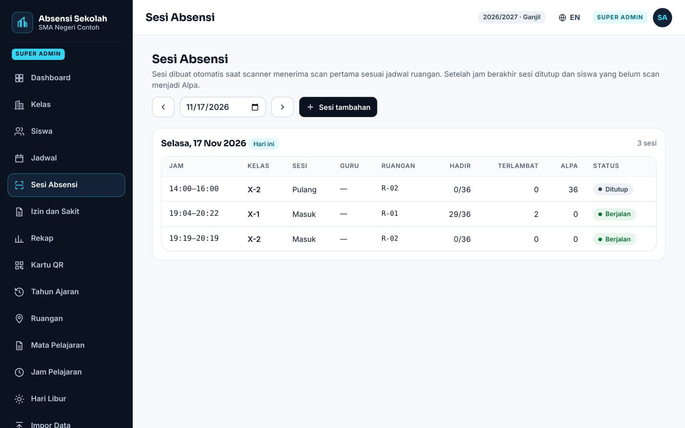

Buka sebuah sesi untuk melihat halaman **live**: jumlah hadir, terlambat, belum scan, dan daftar siswa yang diperbarui setiap 5 detik.

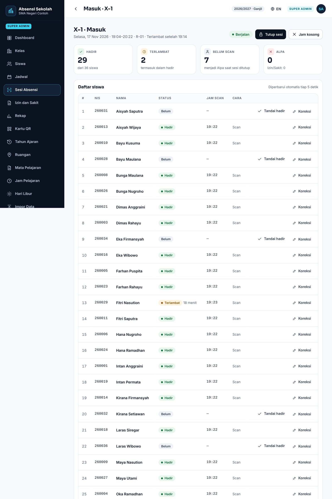

- **Tutup sesi**: siswa yang belum scan dan tidak punya surat izin langsung dicatat Alpa. Bila tidak ditutup manual, scheduler menutupnya otomatis setelah jam berakhir.
- **Jam kosong**: bila guru berhalangan dan kelas tidak belajar, tandai sesi sebagai jam kosong agar tidak menghasilkan Alpa.
- **Buka kembali**: sesi yang sudah ditutup bisa dibuka lagi bila ada kekeliruan.
- **Sesi tambahan**: untuk kegiatan di luar jadwal (misalnya upacara), dibuat dari tombol **Sesi tambahan**.

## Koreksi status

Bila status siswa salah (misalnya lupa scan padahal hadir), guru pengampu, wali kelas, TU, atau Super Admin bisa mengoreksinya dari halaman sesi.

1. Klik nama siswa, pilih status baru.
2. Tulis **alasan** (wajib).
3. Tekan **Simpan koreksi**. Koreksi bisa dihapus untuk kembali ke status asal.

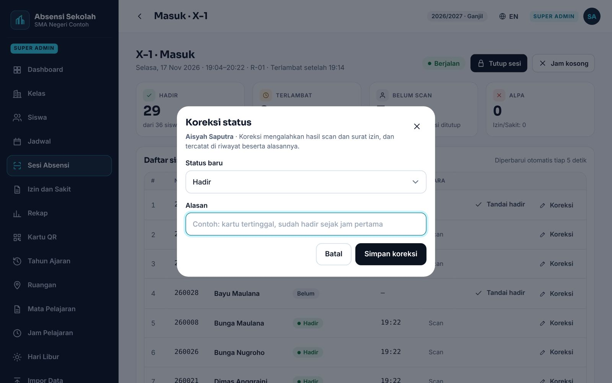

## Izin, sakit, dan dispensasi

Menu **Izin dan Sakit** dipakai TU dan wali kelas untuk mencatat surat.

1. Tekan **Catat izin/sakit**, pilih kelas dan siswa.
2. Pilih jenis (**Sakit**, **Izin**, **Dispensasi**), tanggal mulai dan selesai (paling lama 60 hari), dan keterangan.
3. Lampirkan foto atau PDF surat bila ada.

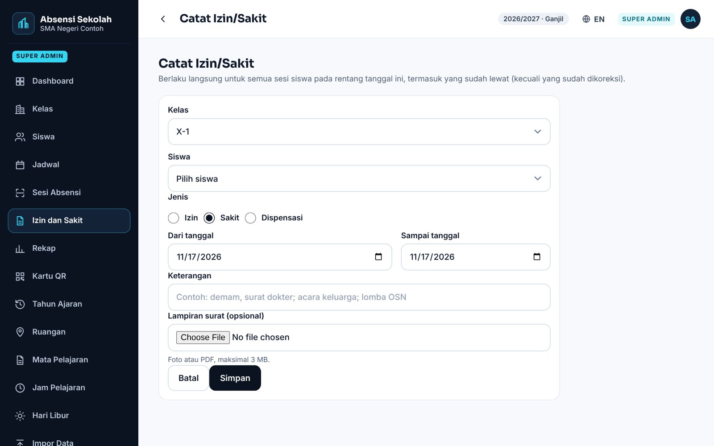

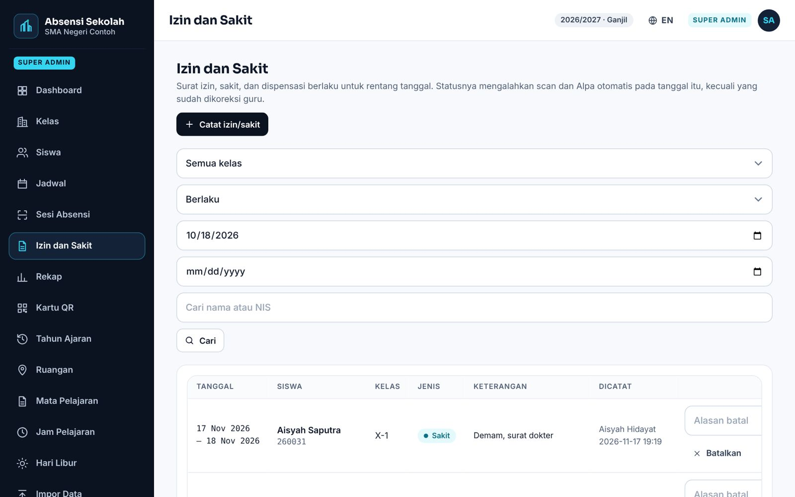

- **Surat menang dari Alpa**: siswa yang punya surat tidak menjadi Alpa saat sesi ditutup, walau surat dicatat setelahnya.
- **Siswa tetap scan** pada hari berizin: jam scan tetap tersimpan, tetapi status harian mengikuti surat.
