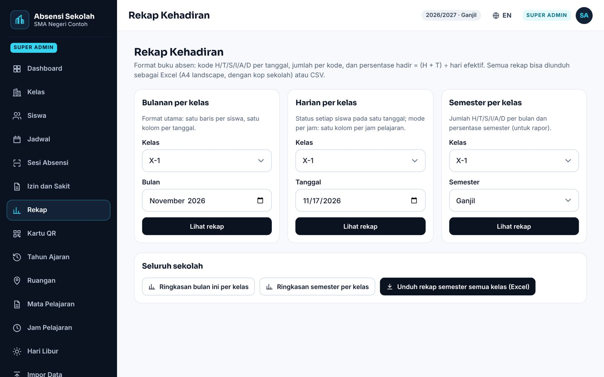
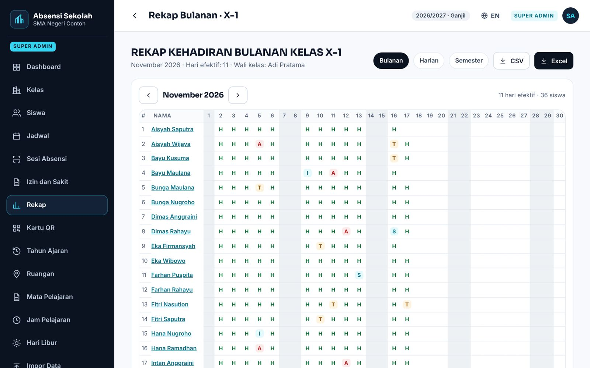
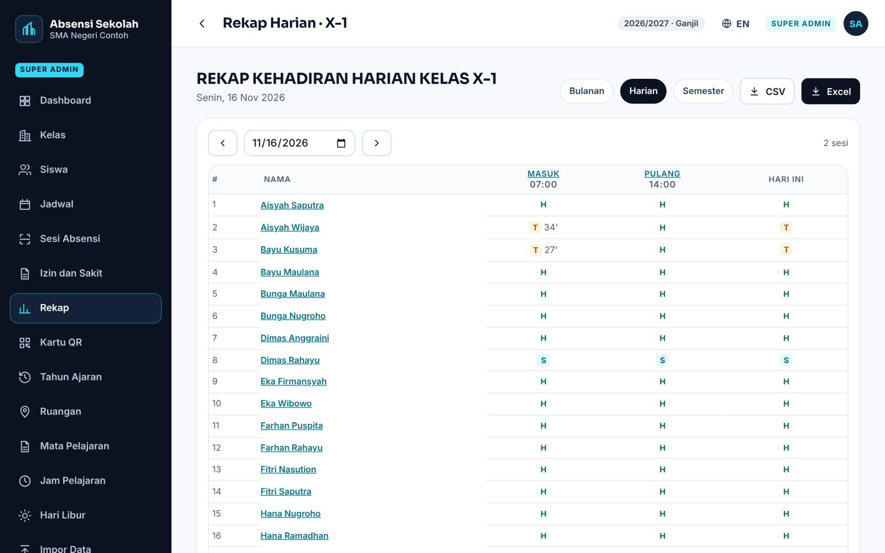
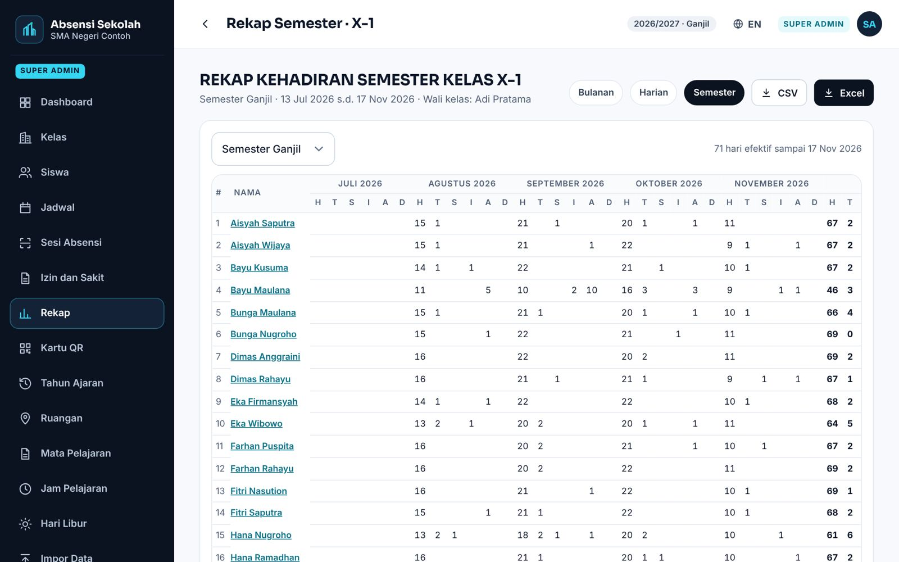
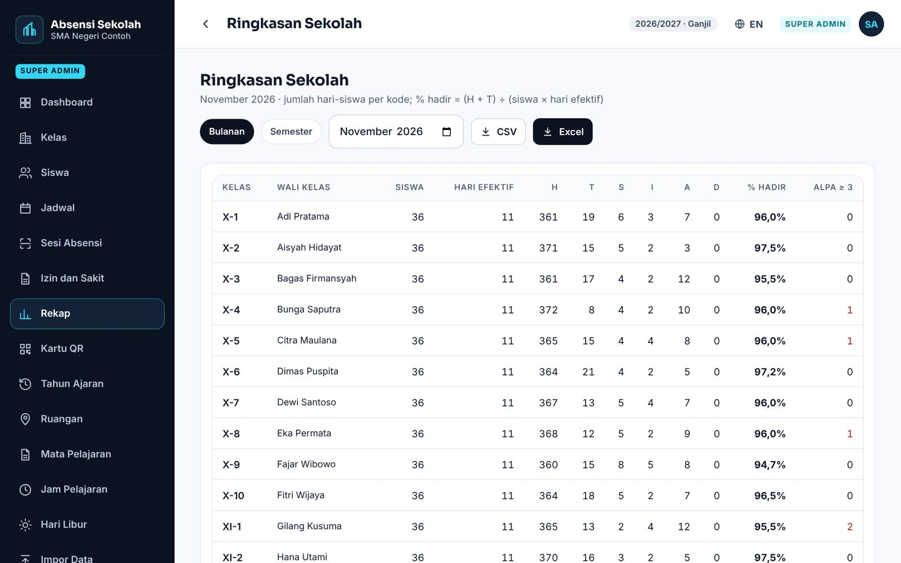
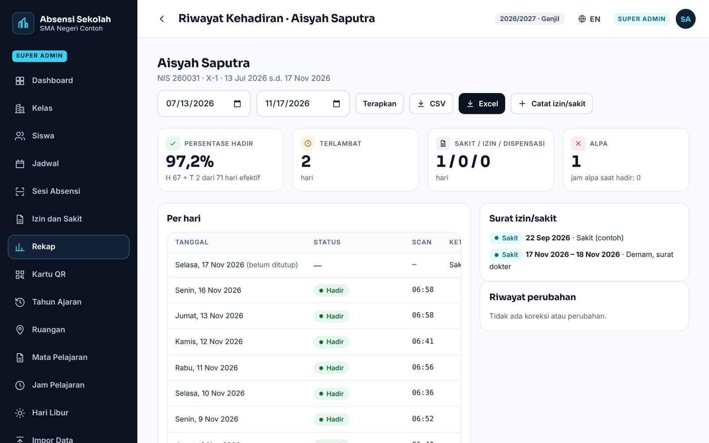

# Rekap dan Laporan

Menu **Rekap** tersedia untuk Super Admin, kepala sekolah, TU, dan wali kelas (hanya kelasnya sendiri).

## Rekap bulanan per kelas

Format yang sama dengan buku absen kelas: satu baris per siswa, satu kolom per tanggal berisi kode H/T/S/I/A/D, tanggal libur diarsir, lalu jumlah setiap kode dan persentase hadir.

## Rekap harian dan semester

- **Harian**: status setiap siswa pada satu tanggal, dengan jam scan pertama.
- **Semester**: jumlah H/T/S/I/A/D per siswa per bulan dalam satu semester.

## Ringkasan sekolah dan riwayat siswa

- **Ringkasan sekolah** (Super Admin, kepala sekolah, TU): persentase hadir setiap kelas dalam satu bulan, diurutkan dari yang terendah.
- **Riwayat siswa**: seluruh riwayat satu siswa, termasuk sesi per jam, surat, dan koreksi beserta alasannya.

## Mengunduh laporan

Setiap rekap punya tombol **Excel** dan **CSV**. Berkas Excel memakai kop sekolah dan kolom tanda tangan kepala sekolah, siap dicetak. Rekap semester seluruh sekolah selesai dibuat dalam beberapa detik.

## Cara status harian dihitung

- **Sesi yang dihitung**: sesi Masuk dan jam pelajaran. Sesi Pulang, sesi tambahan, dan jam kosong tidak dihitung.
- **Hadir** bila sesi pertama yang diikuti siswa berstatus Hadir; **Terlambat** bila sesi pertama Terlambat.
- **Alpa** hanya bila siswa Alpa di semua sesi yang dihitung pada hari itu.
- **Prioritas**: koreksi guru > surat izin/sakit/dispensasi > scan > Alpa otomatis.
