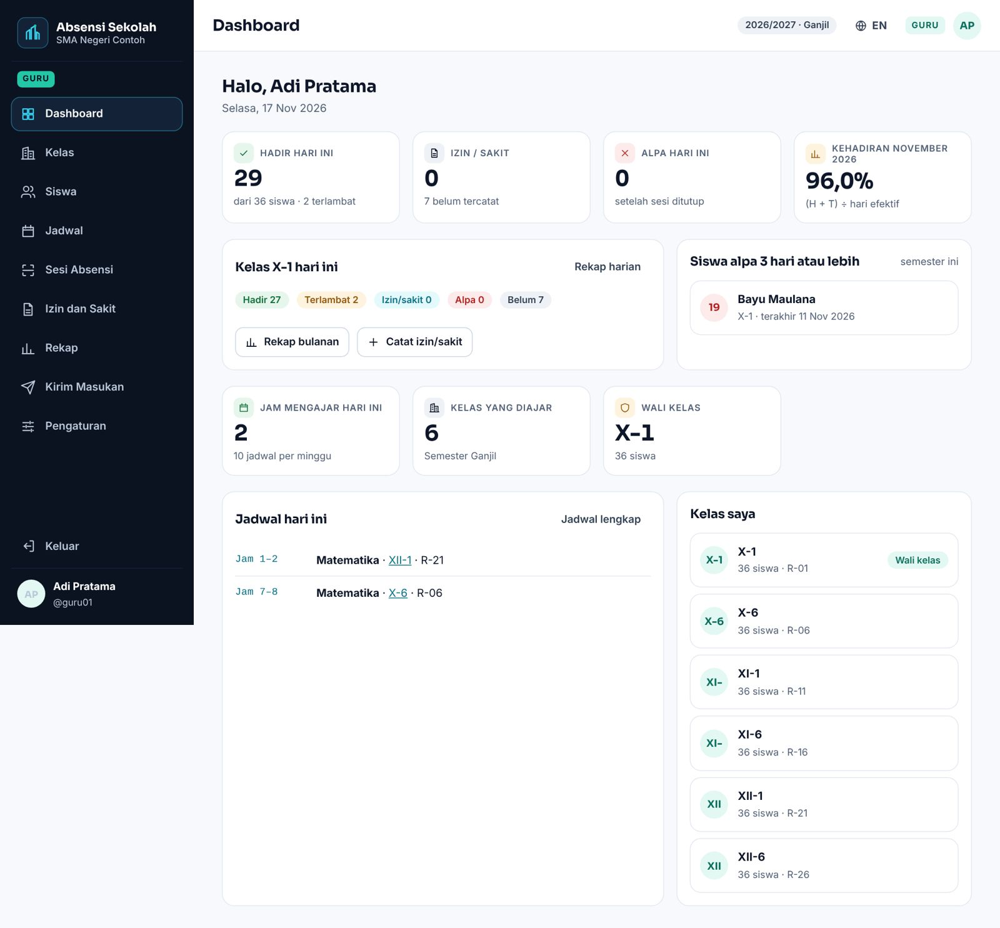
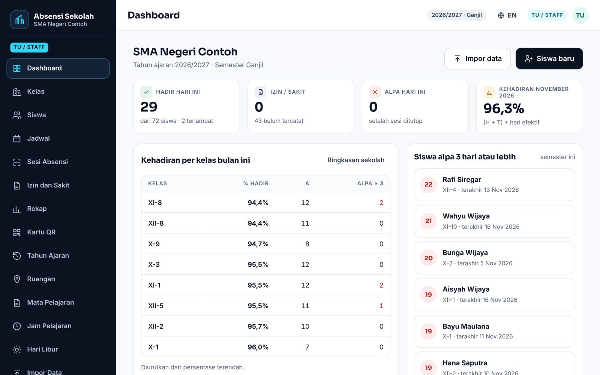
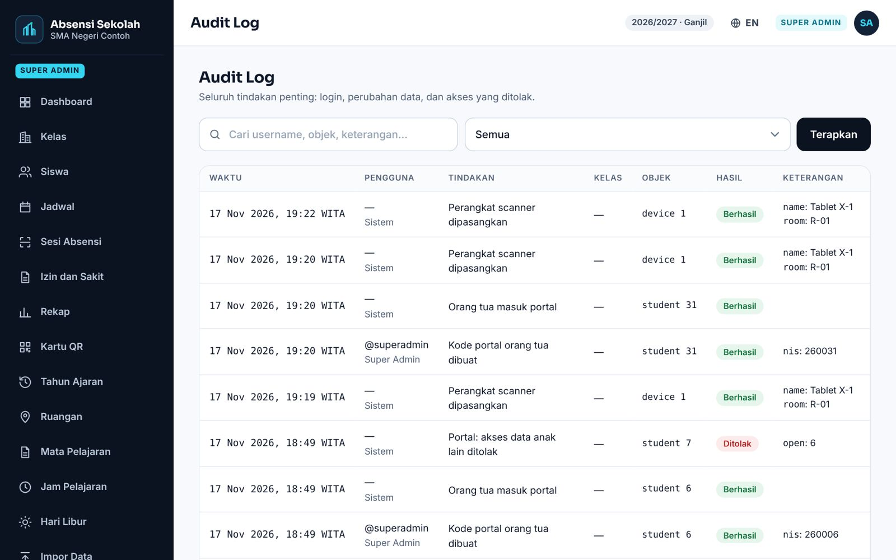

# Panduan per Peran

Ringkasan tugas harian setiap peran. Rinciannya ada di bab-bab sebelumnya.

## Wali kelas

- **Pagi**: buka dashboard. Kartu kelas Anda hari ini menunjukkan berapa siswa sudah hadir dan siapa yang belum.
- **Ada surat**: catat di **Izin dan Sakit** pada hari yang sama, lampirkan foto surat.
- **Siswa lupa scan**: buka sesinya, koreksi status, tulis alasannya.
- **Akhir bulan**: buka **Rekap** → bulanan kelas Anda → unduh Excel.
- **Siswa alpa 3 hari** tampil di dashboard sebagai pengingat untuk dihubungi.

## Guru mata pelajaran

- **Mode per jam**: buka **Sesi Absensi**, pilih sesi jam Anda, pantau halaman live.
- **Tutup sesi** di akhir jam bila ingin Alpa langsung tercatat; bila tidak, sesi tertutup otomatis.
- **Jam kosong**: tandai bila kelas tidak belajar agar siswa tidak menjadi Alpa.
- Guru hanya melihat kelas yang diajar atau diwalikan. Halaman kelas lain ditolak.

## TU / Staff

- **Awal tahun**: tahun ajaran, kelas, impor siswa, kartu QR (Bab 4).
- **Harian**: catat surat izin yang masuk lewat TU, ganti kartu yang hilang.
- **Bulanan**: unduh rekap semua kelas, cetak untuk ditandatangani kepala sekolah.
- **Portal orang tua**: buat kode akses per siswa atau per kelas (Bab 8).

## Kepala sekolah

- **Dashboard**: kehadiran hari ini dan bulan ini, kelas dengan kehadiran terendah, siswa yang sering alpa.
- **Rekap**: ringkasan sekolah dan rekap tiap kelas, bisa diunduh.
- Kepala sekolah melihat semua data tetapi tidak mengubahnya.

## Super Admin

- **Akun pengguna**, **pengaturan sekolah**, **perangkat scanner**.
- **Kesehatan Sistem** setiap pagi pada minggu pertama go-live (Bab 9).
- **Audit Log**: siapa mengubah apa dan kapan, termasuk login gagal dan akses yang ditolak.

