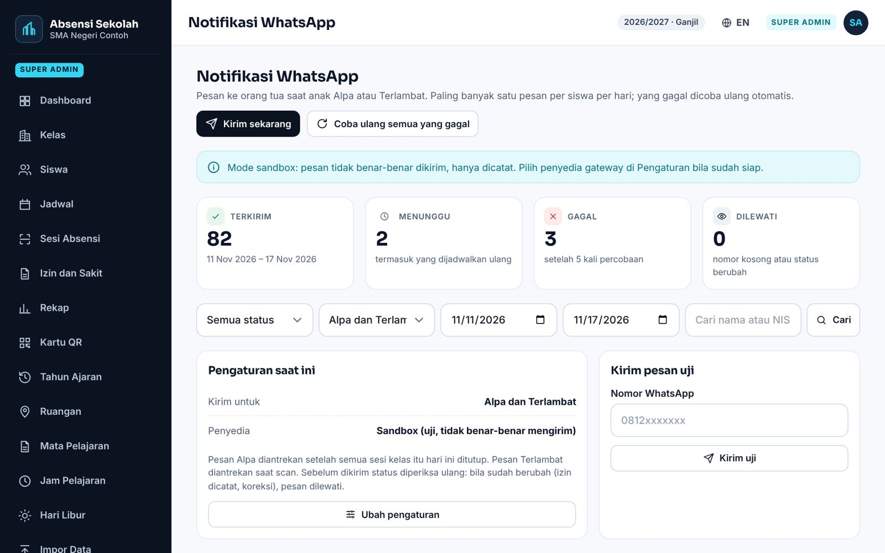
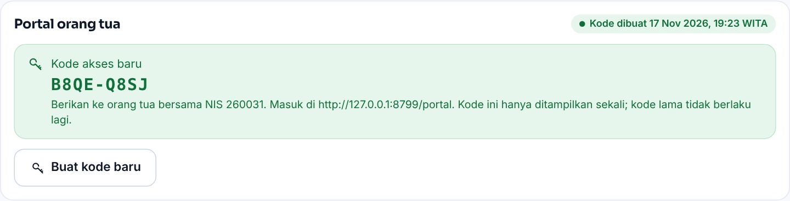
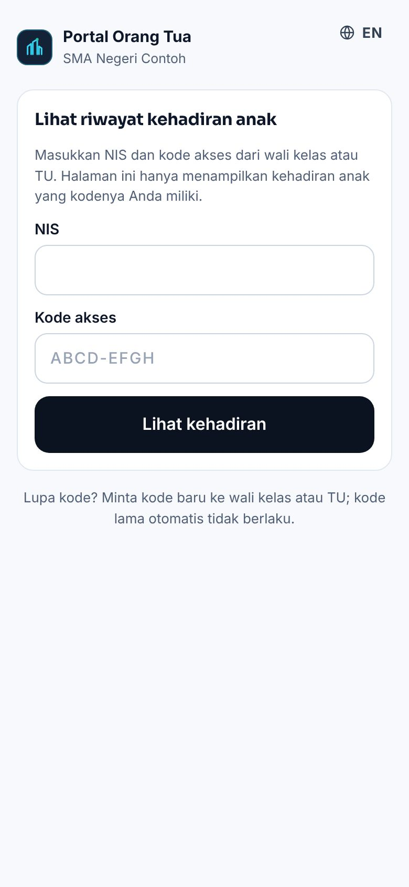
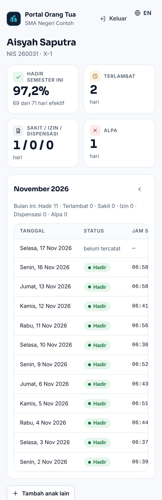

# Notifikasi WhatsApp dan Portal Orang Tua

Kedua fitur ini **mati secara bawaan** dan dinyalakan Super Admin di **Pengaturan**.

## Notifikasi WhatsApp

1. Di **Pengaturan → Notifikasi WhatsApp ke orang tua**, pilih kapan dikirim: Alpa, Terlambat, atau keduanya.
2. Pilih penyedia gateway:
   - **Sandbox**: tidak mengirim apa pun, hanya mencatat. Pakai untuk uji coba.
   - **Fonnte**: isi token dari dasbor Fonnte.
   - **Webhook**: aplikasi mengirim POST JSON `{phone, message}` ke URL Anda dengan header `Authorization: Bearer <token>`.
3. Sesuaikan isi pesan. Isian yang bisa dipakai: `{nama} {kelas} {tanggal} {jam} {menit} {sekolah}`.
4. Buka menu **Notifikasi WA**, kirim **pesan uji** ke nomor Anda sendiri.

- **Satu pesan per siswa per hari**, walau siswa terlambat lalu alpa di jam berikutnya.
- **Terlambat** dikirim saat siswa scan; **Alpa** dikirim setelah semua sesi hari itu ditutup.
- **Gagal kirim** dicoba ulang otomatis; bisa juga dikirim ulang dari halaman Notifikasi WA.
- **Nomor HP** diambil dari data kontak orang tua di data siswa.

## Portal orang tua

Portal memberi orang tua atau siswa akses baca ke riwayat kehadiran anak sendiri.

1. Nyalakan di **Pengaturan → Portal orang tua**.
2. TU membuat **kode akses** 8 karakter dari halaman siswa (satu siswa) atau halaman kelas (satu kelas, bisa dicetak).
3. Orang tua membuka `https://<alamat-sekolah>/portal`, mengisi **NIS** dan **kode akses**.

- **Kode baru** membatalkan kode lama. Buat ulang bila kode tersebar.
- **Salah kode berulang** dikunci sementara.
- Portal hanya menampilkan anak dari NIS yang dimasukkan; percobaan membuka data siswa lain ditolak dan dicatat.
