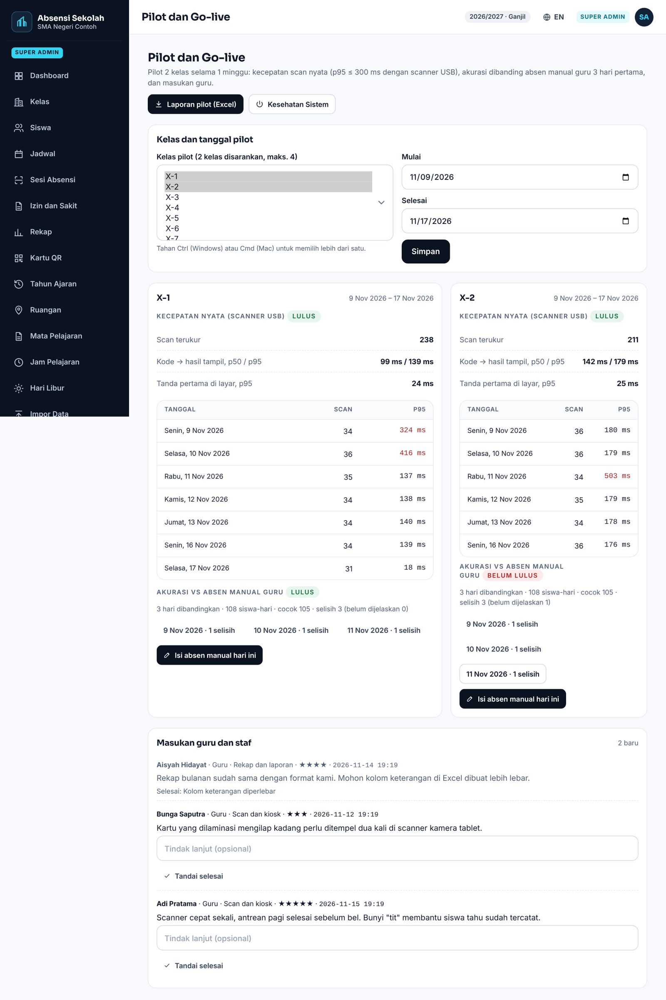
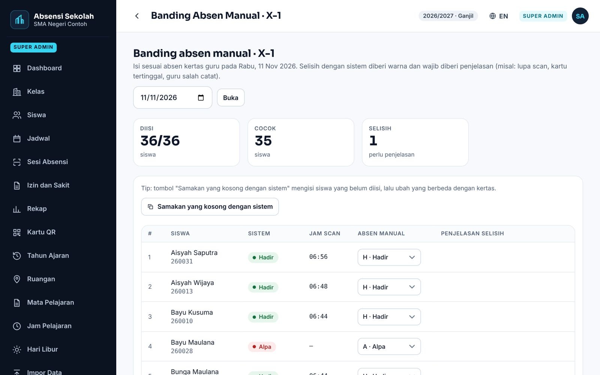
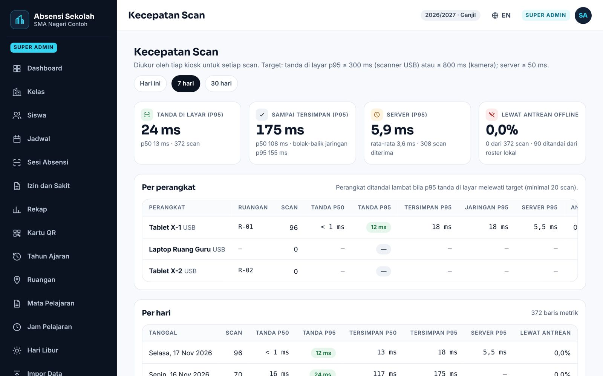
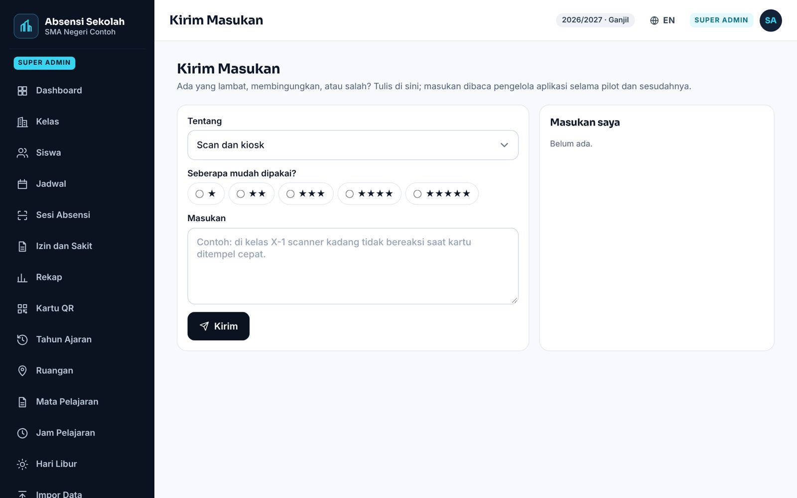
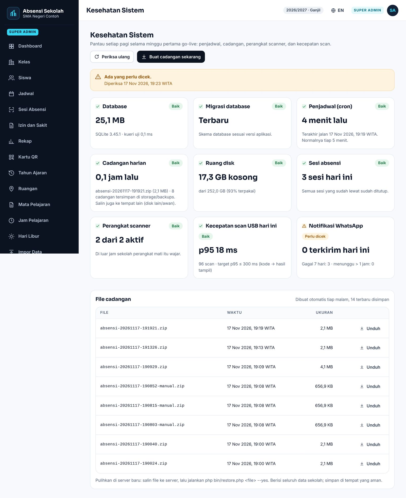

# Pilot, Go-live, dan Pemantauan

Sebelum dipakai seluruh sekolah, aplikasi diuji di dua kelas selama satu minggu. Rencana kerja lengkap ada di `docs/go-live.md`, dan skenario uji per peran ada di `docs/uat-skenario.md`.

## Menyiapkan pilot

1. Buka **Pilot dan Go-live** (Super Admin).
2. Pilih dua kelas pilot dan tanggal mulai serta selesai, lalu **Simpan**.
3. Pastikan kedua kelas sudah punya kartu, kiosk terpasang, dan scanner USB tersambung.

## Kriteria lulus

| Uji | Lulus bila |
| --- | --- |
| **Kecepatan** | Waktu total scan p95 ≤ 300 ms (scanner USB) di kedua kelas selama pilot |
| **Akurasi** | Absen sistem sama dengan absen manual guru 3 hari pertama, atau setiap selisih punya penjelasan |
| **UAT** | Semua skenario per peran lulus dan ditandatangani sekolah |
| **Pemulihan** | Cadangan dipulihkan ke server baru dan aplikasi berjalan lagi dalam < 30 menit |

Halaman Pilot menampilkan status kecepatan dan akurasi setiap kelas, dan bisa diunduh sebagai Excel (lembar Kecepatan, Akurasi, Masukan).

## Banding absen manual

Selama 3 hari pertama, wali kelas pilot tetap mencatat absen di kertas lalu memasukkannya ke aplikasi.

1. Dari halaman Pilot, buka **Banding** untuk kelas dan tanggal.
2. Isi status manual setiap siswa, atau unggah CSV/Excel (kolom NIS dan status).
3. Tombol **Samakan yang kosong dengan sistem** mengisi baris yang belum diisi agar wali kelas cukup mengubah yang berbeda.
4. Baris yang berbeda ditandai merah. Tulis **penjelasan** untuk setiap selisih, misalnya "lupa scan, sudah dikoreksi".

## Kecepatan scan

Menu **Kecepatan Scan** menampilkan waktu tanda di layar, waktu total, dan waktu server per perangkat dan per hari. Angka yang dinilai adalah p95 waktu total untuk scanner USB.

## Masukan guru

Semua pengguna bisa mengirim masukan dari menu **Kirim Masukan**: topik, nilai 1–5, dan pesan. Super Admin menandai masukan yang sudah ditangani.

## Kesehatan Sistem

Halaman **Kesehatan Sistem** (Super Admin) memeriksa:

- **Database** dan **migrasi**.
- **Scheduler**: kuning bila tidak berjalan 15 menit, merah setelah 60 menit.
- **Cadangan harian**: merah bila cadangan terakhir lebih dari 26 jam lalu. Daftar cadangan bisa diunduh dari sini.
- **Ruang disk**.
- **Sesi menggantung**: sesi yang belum tertutup 30 menit setelah jam berakhir.
- **Perangkat scanner**: tidak terlihat 10 menit pada jam sekolah, antrean offline, dan selisih jam perangkat.
- **Kecepatan hari ini** dan **WhatsApp**.

Alamat `https://<alamat-sekolah>/healthz` menjawab 200 bila aplikasi dan database hidup, tanpa data pribadi. Daftarkan alamat ini ke pemantau uptime gratis.

## Minggu pertama setelah rollout

- **Setiap pagi pukul 07:30**: buka Kesehatan Sistem. Semua kartu hijau, semua kiosk terhubung.
- **Setiap siang**: periksa sesi menggantung dan antrean WhatsApp.
- **Setiap hari**: baca masukan baru, perbaiki yang mendesak.
- **Akhir minggu**: unduh rekap mingguan semua kelas dan cocokkan dengan laporan wali kelas.
