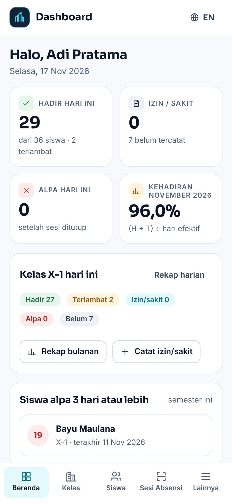
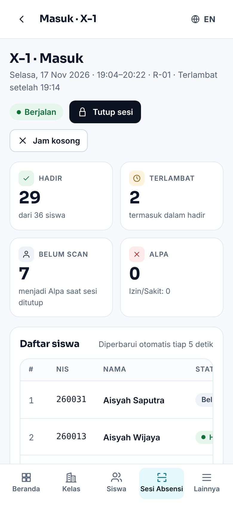
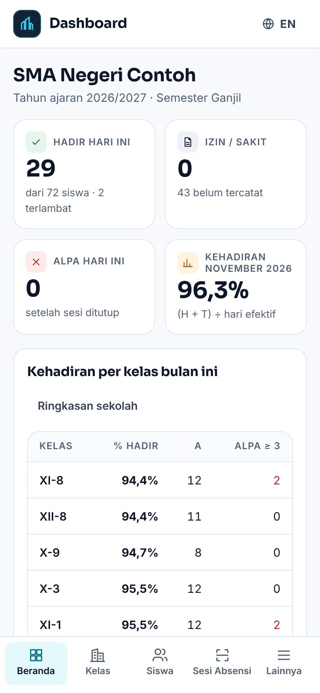

# Tampilan Mobile

Semua halaman bisa dibuka dari ponsel. Menu utama pindah ke bilah bawah (Dashboard, Sesi, Kelas, Siswa), dan menu lainnya ada di tombol **Lainnya**.

- **Wali kelas** biasanya memakai ponsel untuk memantau sesi live dan mencatat izin.
- **Kepala sekolah** cukup membuka dashboard dari ponsel.
- **Tabel lebar** (rekap bulanan) bisa digeser ke samping; untuk dicetak, unduh Excel.

